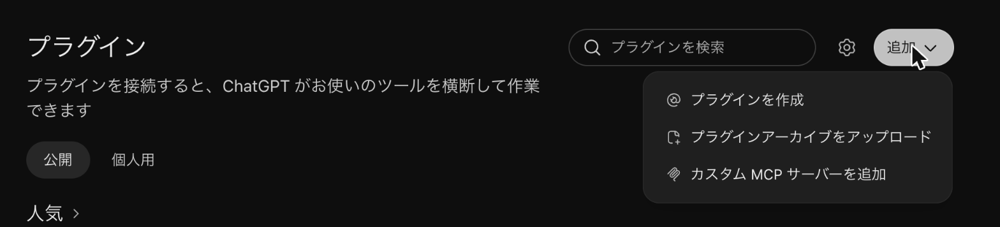
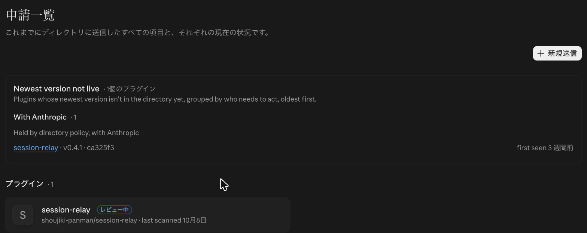

AIの会話を別のAIへ引き継ぐ道具を、自分の session-relay を含めて4つ、READMEで読み比べました。ChatGPTのdots（常に動いているエージェント）から会話を預けられるのは、session-relay だけでした。一方で、会話に混ざったAPIキーを伏せていないのも、session-relay だけでした。

伏せる処理を足して、0.4.2 として公開しました。この記事はその記録です。途中で、Anthropic のプラグイン一覧への提出と、dotsからの預け入れも通したので、そこから書きます。

https://github.com/shoujiki-panman/session-relay

## dotsから、Macへ会話を預けられた

session-relay は新しいチャットで「続きから」と言うと、前の会話を読み込む道具です。仕組みは[前の記事](https://zenn.dev/shoujiki_panman/articles/session-relay-no-handoff)に書きました。スマホのClaudeから会話を「預ける」投函口も、そのときに作っています。

今回はその投函口をChatGPTのdotsにつなぎました。私のdotsは「ちゃま」という名前で、動画づくりを手伝ってもらっています。

最初は、ChatGPTのデスクトップアプリの設定から足したMCPが、別のチャットからは預けられたのにdotsからは見えず、つながりませんでした。ちゃまに頼むと、こう返ってきました。

> ここからRelayを直接呼ぶ入口が見つからず、まだ保存できていない。

chatgpt.com のプラグイン画面で「追加」から「カスタム MCP サーバーを追加」を選び、そこに足し直すと、ちゃまから呼べるようになりました。2回目は、非公開のGitHubのURLが中身に入っていたので、ChatGPTが「送ってよいか」を確かめてきました。URLを抜いて預け直すと、Macに届きました。Macで預かった会話の一覧を見ると、dotsに付けさせた題名「ちゃまからの試し」で並んでいました。



では、ほかの引き継ぎ道具はどうなっているのか。

## 同じことをする道具は、ほかにもあった

ClaudeとCodexの間で会話を引き継ぐ道具を探すと、すぐに見つかりました。READMEを読んで比べた結果です（スター数は2026年10月30日時点）。

| | session-relay | handoff-agent | TStansel/handoff | universal-context-handoff |
|---|---|---|---|---|
| 引き継ぎ方 | 新しい会話のAIが、MCPで取りに行く | 記録を相手側の会話として差し込む | まとめのmdを書いて、次のAIを起動する | 記録とメタ情報を保存して、別のリポジトリで開く |
| 対応 | Claude Code・Codex | Claude Code・Codex・OpenCode | Codex・Claude Code・Cursor | Claude Code・Codex |
| クラウドから預ける | できる | できない | できない | できない |
| 鍵を伏せる | **しない** | する（既定でオン） | READMEに記載なし | する（できる範囲で） |
| スター | 1 | 3 | 20 | 1 |

- handoff-agent：https://github.com/HacksonClark/handoff
- TStansel/handoff：https://github.com/TStansel/handoff
- universal-context-handoff：https://github.com/1beenlee/universal-context-handoff

私はこれまで「本人の発言を要約せずにそのまま渡すのは、session-relay だけ」だと思っていました。違いました。handoff-agent も記録をそのまま相手のAIに差し込みます。

session-relay にしかなかったのは2つです。クラウドのエージェントから預けられることと、AIがMCPで自分で取りに行くことです。ほかの3つは、コマンドで書き出して渡す作りでした。

逆に、自分にだけ無いものがありました。鍵を伏せる処理です。handoff-agent のREADMEには、こう書いてあります。

> Redaction is **best-effort** — the default patterns cover the common API-key shapes (OpenAI, Anthropic, GitHub, AWS, Bearer, PEM)

なぜ session-relay にも必要なのか。

## 記録には、元の鍵が残っている

AIとの会話の記録には、貼ったAPIキーや、AIが表示したトークンがそのまま残ります。Claude Codeのmodで「APIキーの伏せ字」を作ったときにも、[記事](https://zenn.dev/shoujiki_panman/articles/claude-code-mods-first-look)にこう書きました。

> 伏せるのは、Claudeに届く分だけです。画面の表示と、手元に保存される会話の記録には、元の値が残ります

session-relay が読むのは、まさにその手元の記録です。それを別のAIへ渡します。しかも投函口があるので、dotsやスマホのClaudeからも会話が入ってきます。伏せる理由はほかの道具より多いくらいでした。

## 形で分かるものだけを伏せた

足したのは、渡す直前に鍵の形をした文字列を置き換える処理です（[PR #22](https://github.com/shoujiki-panman/session-relay/pull/22)）。

試しに、偽物のOpenAIの鍵とGitHubのトークンを入れた会話を預けて、0.4.2 で読み出しました。預けたのはこういう会話です。

```
このキーで動かして sk-proj-XXXXXXXX…（偽物の鍵）
ghp_YYYYYYYY…（偽物のトークン） で push した
```

読み出すと、こうなります。

```
## 本人が実際に打った言葉（時系列・全件）
1. このキーで動かして [伏せた: OpenAIの鍵]

## 直近の経過
1. [伏せた: GitHubのトークン] で push した
```

伏せるのは、Anthropic・OpenAI・GitHub・npm・AWS・Google・Slack・Stripeの鍵、JWT、Bearerトークン、秘密鍵です。かけるのは、前の会話の文脈、預けた会話、MCPの返事すべての3か所です。手元の記録そのものは書き換えません。

「password=」のような言葉を手がかりにした推測は、しませんでした。それをすると、パスワードの話をしているだけの発言まで壊れるからです。形で鍵だと分かるものだけに絞りました。

テストに書く鍵もリポジトリには直書きしていません。実行のたびに組み立てています。GitHubの秘密の検査に、本物の鍵と間違えられないようにするためです。

では、実際の記録に当てると何が伏せられるのか。

## 手元の記録116本で、伏せたのは2件だった

手元の Claude Code の記録116本に、この処理を当ててみました。伏せたのはJWT 2件だけで、ヘッダーを読むと2件とも本物のJWTでした。鍵ではないものを伏せた例はありませんでした。

少ないのは、普段からキーを会話に貼らないようにしているからだと思います。それでも2件は残っていました。

## npmの公開で、2回つまずいた

0.4.2 として公開しました（[PR #23](https://github.com/shoujiki-panman/session-relay/pull/23)）。

1回目の `npm publish` は「404 Not Found」で失敗しました。原因はnpmのログイン切れで、`npm whoami` を打つと「401 Unauthorized」が返りました。npmはログインしていないときにも「見つからない」と返すことがあります。

公開できた直後には、Macのnpmが古い一覧を覚えていて、`npx` が「0.4.2は無い」と答えました。

```
npm error notarget No matching version found for @shoujiki-panman/session-relay@0.4.2.
```

`npm view` に `--prefer-online` を付けて一覧を取り直すと、すぐにつながりました。

## Anthropicのプラグイン一覧には、提出して審査を待っている

session-relay は Claude Code のプラグインとしても入れられるようにしました（[PR #19](https://github.com/shoujiki-panman/session-relay/pull/19)）。Anthropic のプラグイン一覧（Anthropic Directory）にも、10月8日に提出しています。

提出前の検査は通りました。ただ、MCPを `npx` で起動する作りなので、Anthropic の担当者が中身を読むまで公開されません。10月30日の時点ではまだ審査中です。



提出の画面には「プラグインのプライバシーポリシーが、扱うデータを正確に説明している」という確認がありました。session-relay にはまだプライバシーポリシーがありませんでした。なので、提出の前に書きました（[PRIVACY.md](https://github.com/shoujiki-panman/session-relay/blob/main/PRIVACY.md)）。今回の伏せる処理もそこに書き足しています。

プラグインとして入れるなら、次の2行です。

```sh
claude plugin marketplace add shoujiki-panman/session-relay
claude plugin install session-relay@shoujiki-panman
```

## 自分の道具の弱点は、ほかの道具を読むと見つかる

比べる前、私は session-relay の強みばかり見ていました。ほかの3つのREADMEを読むと、自分の思い込みが1つ外れて、自分にだけ無いものが1つ見つかりました。

足りないものはまだあります。OpenCodeとCursorには対応していません。次はどれから足すか、使う人の声を聞いて決めたいと思っています。
